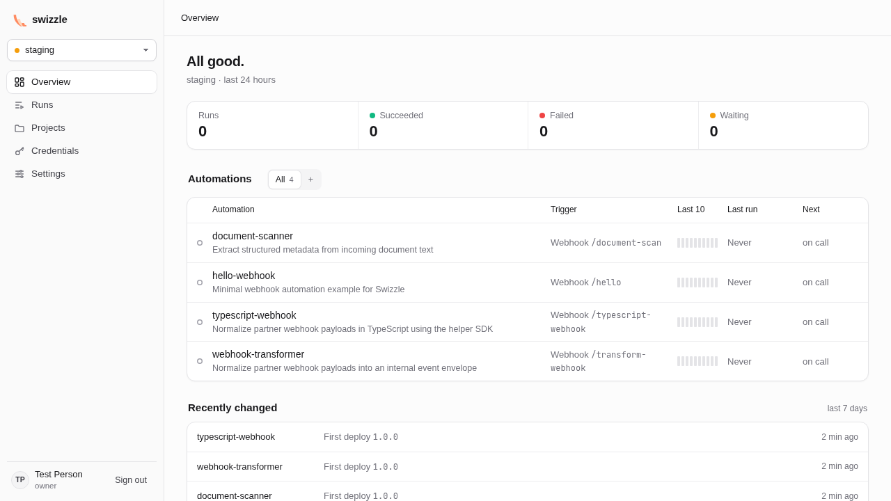

# Swizzle

Swizzle is a self-hosted runtime for automations written as ordinary code.
Write the business logic in Python, JavaScript, or TypeScript. Swizzle handles queues, retries, secrets, versioned deployments, and logs.
It ships as a Docker Compose stack with a dashboard and the `swizzle` CLI.

Use it for scheduled jobs, incoming webhooks, and workflows that need to pause for approval or an external event.
Keep the code in your editor and use the dashboard to inspect runs, manage access, and retry failures.



## Quick start

You need Docker Engine with Compose v2, Git, and [mise](https://mise.jdx.dev).
Run these commands on the host where you want Swizzle to run:

```bash
git clone https://github.com/swizzletech/swizzle.git
cd swizzle
mise trust && mise install
just stack
```

`just stack` writes `.env` with fresh credentials on its first run, then builds the images in Docker and starts the stack.
Open `http://localhost:19826` on that host. Claim the instance with `SWIZZLE_SETUP_TOKEN` from `.env`.
[Install Swizzle on a server](docs/how-to/install.md) covers remote access, HTTPS, mail, and hardening.

## Try an automation

Install the CLI from npm on any machine with Node.js 22.18 or later, then create and run a Python automation:

```bash
npm install --global @swizzletech/cli
swizzle init hello --template python
swizzle validate hello
swizzle run hello
```

This short demo runs trusted code on your host. After [connecting the CLI](docs/how-to/install.md#connect-the-cli) to your instance, deploy it with `swizzle apply hello` to run it in Swizzle's restricted Docker sandbox.
[Build your first automation](docs/tutorials/first-automation.md) walks through the result and deployment.

## Explore

- [Documentation](docs/README.md): tutorials, how-to guides, reference, and explanations.
- [Runnable examples](infra/examples/README.md): complete automations to start from.
- [Runtime contract](docs/reference/runtime-contract.md): inputs, JSON output, logs, and SDK helpers.
- [Security model](docs/explanation/security-model.md): isolation, authentication, and permissions.
- [Changelog](CHANGELOG.md): changes in each release.
- [Contributing](CONTRIBUTING.md): build, test, and propose a change.
- [Security policy](SECURITY.md): report vulnerabilities privately.
- [Code of conduct](CODE_OF_CONDUCT.md): community expectations.

## Status and support

Swizzle is provided as is, without warranty of any kind. The [Apache License 2.0](LICENSE) sets out the terms in section 7, Disclaimer of Warranty, and section 8, Limitation of Liability.
It is maintained on a best-effort basis. The maintainers have no obligation to maintain, support, fix, or update it, and there are no guaranteed response times for issues, pull requests, or security reports.

## License

Swizzle is licensed under the [Apache License 2.0](LICENSE).
