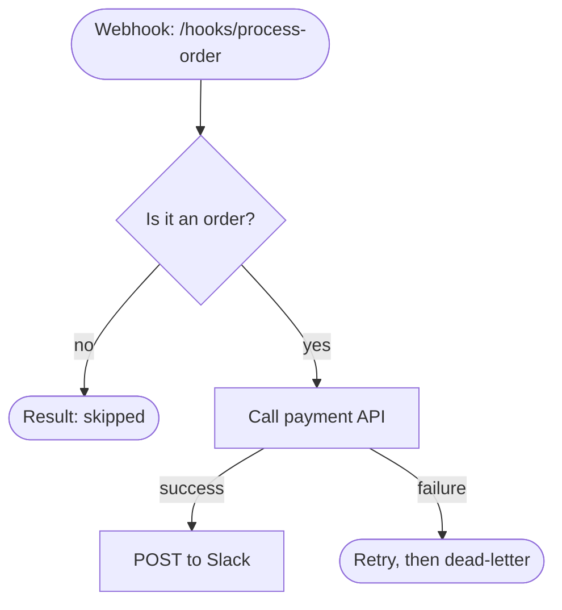

# Build Swizzle Automations

## What Swizzle is

Swizzle is a self-hosted runtime for **code-based** automations. It covers what a workflow tool covers (triggers, scheduling, retries, secrets, logs, versioning), but an automation is a folder of code, not a visual graph of pre-built nodes.

There is no connector catalog. There is no "Slack node", no "Gmail node", no "OpenAI node". The platform ships runtime primitives (queue, retries, secrets, cron, webhooks, chains, rate limits, durable steps, sleep, child invocation, external events, approvals) plus a **connection manager** for OAuth credentials — you still ship the domain logic. This is deliberate — you write better integrations in ten lines of code than a visual builder with 40 config fields, and nothing is locked behind a roadmap.

For services with a plain API key, store it as a secret. For services that require OAuth and have no key to copy (e.g. Google Workspace), use a **connection**: authorize it with the provider's client credentials inline (`swizzle connections authorize <name> --provider google --client-id … --client-secret-env GOOGLE_CLIENT_SECRET --scopes ...`), declare `connections: [<name>]` in `config.yaml`, and read the injected token with `getConnectionToken("<name>")`. A second account can reuse the first's client credentials with `--reuse-from <name>` (e.g. several Google accounts). The platform runs the OAuth flow and refreshes tokens; you never handle refresh tokens or client secrets. See `references/config-reference.md` for the full `connections:` contract. This is credential infrastructure, not a pre-built integration catalog — the API calls are still your code.

Your job: translate the user's intent into a folder with `config.yaml` + an entrypoint script, validate it, deploy it, and hand back something that runs reliably. The platform handles everything else.

## Install and connect from an author's laptop

Use Node.js 22.18 or later. Install the CLI from npm:

```bash
npm install --global @swizzletech/cli
swizzle --version
```

The package carries the SDKs and this skill. It needs no source checkout, Docker, or database on the laptop. Python is needed for local Python runs.

A person creates a device token in the remote instance's **Settings > Agent access** and supplies it through `SWIZZLE_TOKEN`. Use the instance's HTTPS API URL and an existing environment:

```bash
swizzle profile add server --url https://swizzle.example.com/api --token-env SWIZZLE_TOKEN --env staging
swizzle profile use server
swizzle doctor
mkdir my-automations && cd my-automations
swizzle workspace init .
```

`workspace init` needs a new, empty folder. It writes `AGENTS.md`, `automations/` and this skill in `.agents/skills/swizzle-builder/`, and links `.claude/skills` to it. Write each automation under `automations/`. `validate` and `apply` contact the remote instance. `run` executes trusted code locally. `trigger` runs a deployed automation on the server.

## Read the user before you build

Users show up at very different levels. The single biggest mistake is building before you've calibrated. Listen to how they talk, not just what they ask for.

**Someone already thinking in platform terms** ("webhook on /orders, retry 5x, call Stripe, forward to Slack") knows what they want. Build it. Still flag things that are actually wrong — wrong retry strategy, leaky secret handling, obviously unbounded cost. Say so directly, don't tiptoe.

**Someone describing a goal** ("I want to automatically process invoices from my email") has usually not thought about the mechanics. That's your job. Before writing code, quietly work out — either by asking or by reasoning — the things they haven't decided yet:

- How often does this run? Once a day, or thousands of times an hour? Different architecture.
- What counts as "already done"? Filename, content hash, email Message-ID, database flag? This is idempotency.
- What happens on bad input? Corrupt file, timeout, empty response, wrong format. Skip? Retry? Alert?
- What external services are touched? Each is a failure point with its own cost, rate limit, and downtime.
- Is the output destructive? Renames, deletes, sends messages — these can't be undone.
- What's the acceptable latency? "Instantly" means webhook. "Within the hour" means cron every 5–15 min.

Don't interrogate people. If three questions cover it, ask three. If it's obvious from what they said, just build. If something they said won't actually work — a 5-second cron on a 30-second API, storing secrets in code, renaming without a uniqueness check — say that plainly and propose the fix.

**The goal is to put yourself in architect mode on their behalf.** They want the thing to work in production, not a proof of concept.

## Think through the chain

Every automation is a chain: **trigger → input → processing → external calls → output → state.** Each link has failure modes and cost implications. Walk through all of them before writing code.

| Link | What to think about |
|---|---|
| **Trigger** | Webhook (instant, external can hit it), cron (scheduled, you control cadence), chain (reacts to another automation). Match cadence to data change rate — polling every 5s for hourly data is waste |
| **Input** | Trust nothing. Files can be empty, corrupt, huge, have weird encodings. Webhook payloads can be missing fields, duplicated, replayed. API responses can be HTML error pages pretending to be JSON |
| **Processing** | What runs in the managed Debian sandbox? Fonts? Binaries? Memory? (See next section) |
| **External calls** | Slow, expensive, rate-limited, flaky. Only call when there's real work to do, never on empty polls. Distinguish retryable (429/503/timeout) from permanent (400/401/404). AI outputs are non-deterministic — validate before using as filenames or DB keys |
| **Output** | Renames, deletes, sends — often irreversible. Atomic writes (temp file + rename). Dedup messages. Idempotency keys on external POSTs |
| **State** | If it runs more than once, it needs durable state. Use the Swizzle state primitive for small JSON cursors (`state_get/set`), and `claim(key)` before a side effect that must happen once per key: two deliveries of the same order can run at the same time, and only `claim` tells them apart |

For deeper checklists — idempotency strategies, edge cases per input type, resource patterns — see [Best Practices](references/best-practices.md).

## Execution environment (what's actually available)

Deployed automations run as the unprivileged user `65532` inside a read-only Debian 13 sandbox: the runner image, built from the `runner-base` target of the instance's [Dockerfile](https://github.com/swizzletech/swizzle/blob/main/infra/docker/Dockerfile). **Only what that image installs exists.** Trusted local `swizzle run` remains a host-process authoring convenience. Verify every production dependency before writing code that depends on it.

**Installed by default:**
- Node.js 26 with npm, and Python 3.13 with pip and venv
- poppler-utils: `pdftoppm`, `pdftotext`, `pdfinfo` and the other poppler tools
- Fonts: DejaVu Sans, DejaVu Serif and DejaVu Sans Mono, and no other font
- `bash`, `curl`, `git`, `claude` and `codex`

The exact packages: Debian `bash`, `ca-certificates`, `curl`, `fontconfig`, `fonts-dejavu-core`, `git`, `poppler-utils`, `proxychains4`, `python3`, `python3-pip`, `python3-venv`; npm `@anthropic-ai/claude-code`, `@openai/codex`.

**Not installed:** ffmpeg, ImageMagick, LibreOffice, Chromium/Puppeteer, any browser, `gh`.

Declare every binary the automation starts as a subprocess under `runtime.requirements.binaries`. Against an instance, `swizzle validate` and `swizzle apply` check each one against the binaries of its runner image, so a missing one fails before the deploy instead of in a run. Neither you nor the automation can add a binary, and installing one inside a run fails on the read-only file system: the instance operator adds it to the runner image and rebuilds the stack. An operator may have added tools, so a binary missing from this list can still pass `validate`.

**Automation files** are the deployed bundle under `/automation`. A deployed run starts with `/automation` as its current working directory, on a read-only file system, so a relative write fails. Scratch files go under `$SWIZZLE_RUN_TMP` (`/tmp`, an ephemeral tmpfs); a relative path is writable only under a directory listed in `runtime.permissions.writable_dirs`. The container's home directory is also ephemeral and receives no operator files. Never hardcode a host path or use `~/` for durable state.

## Translate human intent into platform constraints

| User says | What it really means | You have to think about |
|---|---|---|
| "Watch a folder" | Cron polling a remote inbox API reachable from the deployed run | State primitive for processed IDs/hashes, content hashing, cleanup |
| "Convert PDF to image" | poppler rendering | Fonts, DPI, output format, empty pages |
| "Call GPT / Gemini / Claude" | API call with potentially large input | Secret for key, long timeout, dispatch `rate_limits` plus `pace()` for in-run calls, base64 for images |
| "Rename / organize files" | Filesystem writes | Dup-safe naming, unicode, path sanitization |
| "When I press a button" | Webhook | Tell the user the URL to configure in Stream Deck / Shortcuts / Tasker |
| "Every morning at 8" | Cron | `"0 8 * * *"` — UTC. Ask timezone if unclear |
| "Process my emails" | IMAP poll via cron | Secrets, encoding quirks, mark processed, IMAP is slow |
| "Sync X to Y" | Cron with external calls both sides | Conflict resolution, what wins on divergence, cursor |

If something a user asks for can't be done in this container (no ffmpeg, no browser), say so and offer the alternative — different binary, API-based approach, or asking the instance operator to add it to the runner image.

## Integrating with external services

**Research the API first.** APIs change constantly and your training data is stale for most of them. Before writing integration code, check current docs with the tools available to you — WebFetch, WebSearch, relevant MCP servers. Wrong endpoints, deprecated auth schemes, and outdated response shapes waste runs and dead-letter fast. Cheaper to look it up than to debug it later. For rate-limit planning baselines per vendor, see [Operations — third-party rate limits](references/operations.md#common-third-party-rate-limits); for library-specific traps already hit in production, see [Integration Gotchas](references/integration-gotchas.md).

**Trust the user's named model version.** This applies most strongly to AI model names. If the user says "Gemini 2.5 Flash Lite" or "Claude Haiku 4.6" or any specific version, *use it* and look up the current API — don't substitute a model you remember from training data. Provider catalogs change monthly and your knowledge of them is stale. Only push back if you've searched the provider's current docs and the name genuinely doesn't exist — and when you do, cite what you found rather than asserting from memory.

**AI integrations go two different ways.** Pick deliberately:

- **Direct API calls** — the Anthropic / OpenAI / Gemini SDK, one secret for the key, `runtime.timeout` bumped up for slow completions, optional `rate_limits` plus SDK `pace(name)` around in-run calls. Right when the automation is one focused prompt → response. See recipe #7.
- **Headless CLI calls** — `claude -p "..."`, `codex exec ...`, or similar. More powerful because the CLI brings its own tool use (file reads, searches, shell, sometimes MCP servers on top). Right when you want the AI to orchestrate multiple subtools on behalf of the automation. This path has several non-obvious traps — non-interactive flags, stdout capture, credential scoping, and writable directories. Read the [headless CLI entry in Integration Gotchas](references/integration-gotchas.md#headless-claude--codex-cli-in-the-worker-blocks-refuses-to-run-or-hides-its-errors) before writing one.

Both paths still run inside the managed runner sandbox. Any CLI you invoke has to be installed in the runner image. The default image ships `claude` (`@anthropic-ai/claude-code`) and `codex` (`@openai/codex`); [Execution environment](#execution-environment-whats-actually-available) lists the rest.

## Agent workflows

When a job is bigger than one run — a spec that becomes code that gets reviewed and verified, a classifier that routes to specialists, a fan-out of checks that a final stage joins — you're designing a **pipeline**, not an automation. The durable primitives (`runStep`, `sleep`, `invokeAutomation`, `waitForEvent`, `requestApproval`) are the mechanism; this is the layer above them. If the whole thing fits in one run under `runtime.timeout`, skip all of this and write one entrypoint.

**Two execution layers, and every decision picks one:**

- **In-run (one stage, ≤ `runtime.timeout`, ceiling 1h):** a live process with full parallelism — `Promise.all`, parallel headless agent sessions (`claude -p`, `codex exec`), LLM loops, judge panels. `runStep` memoizes but does **not** suspend. Live sessions can be steered within the run and die with it.
- **Cross-run (between stages):** `invokeAutomation` / `sleep` / `waitForEvent` / `requestApproval` each write a suspend sentinel and `exit(0)`, so **durable waits are strictly sequential** — never `Promise.all` over them; only the first fires. Stages compose by chain, by join, or by dynamic invoke.

**Stage doctrine:** a stage is one run — one fresh context window, unbiased by construction (the reviewer shouldn't see the builder's chat). Handoffs carry **artifacts, never session state**: `{ repoUrl, branch, sha }` for code, findings JSON, storage refs — never worker-local paths, transcripts, or live sessions. Escalation ends the stage with an artifact and a wait; a *fresh* session resumes from question + answer + workState.

**Which shape:** static pipeline known ahead of time → chain triggers (and the `sources:` join for fan-in); composition decided at runtime or a fix-loop → `invokeAutomation` (sequential, depth ≤ 8); everything parallel-and-joined-fast → inside one stage.

Full model catalog, the join-trigger contract, sandbox/clone doctrine, and headless-session guidance: [Agent Workflows](references/agent-workflows.md).

## Build loop

Creating or editing — same loop. For edits, read the existing folder first (`swizzle inspect <name>` for the deployed state, the actual files, and `swizzle logs <name>` or `diagnose` if it's misbehaving), then change `config.yaml`, entrypoint, `README.md`, and `flow.mermaid` together. `apply --dry-run` shows the exact diff against the active deployment before you touch state.

```bash
# 1. Discover what's available — the CLI self-documents
swizzle scaffolds --json       # shows patterns × languages
swizzle schema config --json   # the live config.yaml contract

# 2. Scaffold (new) — or read the existing folder first (edit)
#    The folder name becomes the automation name, unique across the whole instance (see below)
swizzle init office-contact-intake --template typescript --pattern webhook-basic
#    A webhook scaffold gets a random path and a signing secret; store a random key for it
export OFFICE_CONTACT_INTAKE_SIGNING_SECRET="$(openssl rand -hex 32)"
swizzle secret set OFFICE_CONTACT_INTAKE_SIGNING_SECRET --value-env OFFICE_CONTACT_INTAKE_SIGNING_SECRET

# 3. Customize files for the actual use case — including README.md and flow.mermaid
#    Mandatory storage decision:
#    ephemeral files -> $SWIZZLE_RUN_TMP (cwd /automation is read-only when deployed; auto-cleaned)
#    durable small JSON -> state primitive (state_get/set); once per key -> claim
#    durable files -> external target/storage, never worker-local filesystem

# 4. Validate locally — fast, catches config + entrypoint mistakes
swizzle validate office-contact-intake
swizzle run office-contact-intake     # uses sample-payload.json if present

# 5. Preview the deploy — shows diff against active, no state change;
#    fails with the error apply would give, such as a taken name
swizzle apply office-contact-intake --dry-run

# 6. Deploy — registers trigger, shows in dashboard
swizzle apply office-contact-intake

# 7. Test live — prefer the CLI (uniform env, auth, and payload handling; no signature needed):
swizzle trigger office-contact-intake --payload '{"key":"value"}'
# A request to the webhook URL must carry the signature; the scaffold's README.md has the curl

# 8. Inspect what happened
swizzle logs office-contact-intake
```

**Automation names are unique across the whole instance, not per project.** A name that an automation in another project holds, even a project you cannot see, fails `swizzle validate`, `swizzle apply --dry-run` and `swizzle apply` with `AUTOMATION_PROJECT_MISMATCH`, and `swizzle list` does not show it. Pick a specific name before you scaffold: what it does, prefixed with the team, client or project it serves (`office-contact-intake`, not `contact-form`). When the name is taken, change `name` in `config.yaml` (and the folder, to keep them aligned) and validate again; do not reuse the name with `--project`.

**`apply` is the deploy command.** It's idempotent, and `--dry-run` shows the exact diff against the currently-active deployment before touching state — you see what changes before it changes.

**Why scaffold first, even for hand-written automations:** the scaffold vendors `swizzle_sdk.py` / `swizzle-sdk.ts` into the folder. To write an automation by hand, scaffold it anyway and replace the entrypoint, so you keep the SDK instead of writing against the raw contract.

For durable steps, sleep, child invocation, external events, and approvals, use the vendored SDK helpers documented in [SDK Usage](references/sdk.md). The raw sentinel contract exists for plain Node, but SDK authoring is the default.

An approver sees only the automation, the step and the approval's `details`, nothing else about the run. Lead `details` with a `title` or `summary` that states the decision, and add the facts it rests on as flat fields: the approval page and the dashboard's approval card both show the heading and each other field as a labelled line. [SDK Usage — events and approvals](references/sdk.md#events-and-approvals) has the full rule.

```python
request_approval("approve-payment", details={
    "summary": "Pay 1,240.00 EUR to ACME GmbH for invoice INV-1042?",
    "due": "2026-11-03",
})
```

## The execution contract

Every automation is one process:

1. **Read** JSON from **stdin** — the trigger payload
2. **Do work**
3. **Write** one JSON object to **stdout** — the run result
4. **Exit 0** for success; any other code is failure and triggers retry

Logs and debug output go to **stderr** (captured and shown in the dashboard). Anything on stdout that isn't the single result JSON corrupts the run — this is the #1 mistake. No `print("debug")` in Python, no `console.log(...)` in Node.

The SDKs wrap this contract so you rarely think about it. Canonical TypeScript entrypoint:

```typescript
#!/usr/bin/env node
import { runAutomation } from "./swizzle-sdk.ts";

await runAutomation(async ({ payload, metadata, logStep }) => {
  logStep("processing", { keys: Object.keys(payload) });
  const apiKey = process.env.MY_API_KEY;
  const result = await doTheThing(payload, apiKey);
  return { status: "ok", data: result };
});
```

Python with SDK, raw Node, and raw Python variants — see [SDK Usage](references/sdk.md).

## Storage decision rule

Pick storage before writing code:

- **Ephemeral files**: write under `$SWIZZLE_RUN_TMP`, never to a relative path. In a deployed run the cwd is `/automation` on a read-only file system and `SWIZZLE_RUN_TMP` is `/tmp`; the worker deletes the scratch directory after success, failure, timeout, or cancel. A local `swizzle run` starts in its scratch directory, so build every path from `SWIZZLE_RUN_TMP` and it works in both.
- **Durable small JSON state**: use the state primitive. TypeScript: `await stateGet("cursor")`, `stateSet("cursor", next)`. Python: `state_get`, `state_set`. Save after each successful external side effect. A run reads state as it was when it started, so never deduplicate with "if the key is unset, act, then set it": two concurrent runs both act. Use `await claim(id)` (Python `claim(id)`) before a side effect that must happen once per id ([SDK reference](references/sdk.md#do-a-side-effect-once)).
- **Durable files**: never use the worker filesystem as the durable store. Push files to the target system or external storage from the automation: S3-compatible storage via declared secrets, Google Drive via the connections layer, or the business system's own upload API.

Inspect or repair state with `swizzle state list <name>`, `state get|set|delete <name> <key>` (`set` takes a JSON value).

## config.yaml essentials

Only `name`, `version`, and `trigger` are required. Defaults handle the rest.

```yaml
# Webhook — the most common trigger
name: office-contact-intake   # unique across the instance
version: 1.0.0
trigger:
  type: webhook
  path: /hooks/office-contact-intake-3f9c1a7e5b2d8c4f6a0e9b1d  # required to deploy; random, as `swizzle init` writes it
  signature:              # HMAC-SHA256(rawBody) check before enqueue; `swizzle init` writes it
    secret: OFFICE_CONTACT_INTAKE_SIGNING_SECRET
    header: x-swizzle-signature
    prefix: sha256=
  payload_schema:         # optional JSON Schema; local run + webhook ingress enforce it
    type: object
    required: [event]
    properties:
      event:
        type: string
```

```yaml
# Cron — standard expression or interval shorthand
trigger:
  type: cron
  schedule: "0 * * * *"   # UTC
  # every: "5m"           # alternative: 30s, 5m, 1h, 2h30m, 1d (min 30s)
```

```yaml
# Chain — fires when another automation finishes
trigger:
  type: chain
  source: upstream-automation
  on: succeeded           # succeeded | failed | dead-lettered | finished
  payload: result         # result | payload | full
```

Add these when you need them:

```yaml
secrets:
  - API_KEY              # declared by name; value lives in the secret store or shell

vars:
  PROCESSING_MODE: dry-run # plaintext config, injected as env vars
  MAX_ITEMS: 25

runtime:
  timeout: 120s           # default 60s
  retry:
    max_attempts: 5       # default 3
    backoff: exponential  # default exponential; fixed available
  rate_limits:
    external_api: "60/min"  # formats: /sec, /min, /hour
  requirements:
    python:
      requirements_file: requirements.txt
    node:
      package_json: package.json
      lockfile: package-lock.json
    binaries:
      - name: ffmpeg
```

Production workers run every deployed run in the container sandbox, whatever `execution_mode` says. The mode only changes a trusted local `swizzle run`: `host` and `profile` run a host process, `container` runs the sandbox.

Config fields, profiles, permissions, and advanced runtime options: [Config Reference](references/config-reference.md). Ready-made configs for common shapes: [Recipes](references/recipes.md).

### Run on a specific machine

When the user names a machine or a capability ("on the GPU box", "with the local LLM"), pin the automation to its worker group. Never put a host, IP, port or worker token in code or config; you only name a group.

1. `swizzle worker groups --json` lists the groups that serve the project in this environment, with each machine's name and state. Pick the group whose machine the user means, such as `gpu-home`. A group missing from the list cannot run here; ask an owner or admin to grant a worker instead of choosing another group.
2. Set `runtime.profile: gpu-home` in `config.yaml`. For the GPU machine's model, also add `local-llm` under `runtime.permissions.services` and call `SWIZZLE_LOCAL_LLM_URL` with `SWIZZLE_LOCAL_LLM_TOKEN`; both arrive in the run's environment.
3. Tell the user that a run waits while every machine of the group is off, up to `runtime.queue_timeout` (default `24h`), then fails with `PLACEMENT_TIMEOUT`. It never runs in another group. Waiting spends no attempt.
4. A run stays `queued`? `swizzle diagnose <runId>` says why it waits (no worker granted, machine offline, local LLM unhealthy, all slots busy) and when it gives up.

`runtime.profile` is unrelated to the CLI's `--profile`, which picks the Swizzle instance ([Profiles vs. environments](#profiles-vs-environments--two-independent-axes)).

## Automation documentation (`README.md` and `flow.mermaid`)

Every automation gets both a `README.md` and a `flow.mermaid` file. The dashboard renders both on the automation detail page: the README explains how the automation behaves and is operated, while the Mermaid diagram communicates the flow at a glance. Without current documentation, the automation is a black box.

Rules:

- **Create both files for every new automation.** Not optional.
- **Update both whenever the logic changes.** Any change to behavior, inputs or outputs, triggers, branching, external services, secrets or connections, state, failure handling, or operational usage requires a matching README and Mermaid update. Treat `config.yaml`, the entrypoint, `README.md`, and `flow.mermaid` as a synchronized set.
- **Keep the README operationally useful.** Document purpose, trigger/input, output or side effects, required secrets/connections, relevant state or idempotency behavior, and how to test or operate the automation. Do not include secret values.
- **Keep the diagram honest.** Show actual branching (success / error / skip), external services touched, state reads/writes. Don't hide the retry or dead-letter paths if they matter.
- **Name a node after its step.** A node whose id equals a step name (`parse[Parse the payload]` for `runStep("parse", …)`) is lit in the dashboard while that step runs. `swizzle validate` warns where the ids and the step names differ; the warning never blocks a deploy.
- Pure formatting, comment-only, or internal refactors that do not change behavior do not require rewriting the files, but verify that both still describe the resulting automation accurately.

Minimal example, for an entrypoint with the steps `check`, `charge` and `notify`:



The webhook caller has its answer before the run starts, so no step returns an HTTP status. A payload that fails `trigger.payload_schema` never becomes a run: ingress answers `WEBHOOK_PAYLOAD_INVALID`. A run that finds nothing to do returns a result that says so, such as `{"status": "skipped"}`.

## Vars and secrets

Use `vars:` for plaintext configuration and `secrets:` for credentials.

- A **var** is anything you would be comfortable printing in a log line: modes, dry-run flags, thresholds, delays, batch sizes, feature toggles.
- A **secret** is a credential or sensitive value: API keys, tokens, passwords, signing keys, private URLs.
- Vars live in `config.yaml`, are versioned with the automation code, and are injected into local and deployed runs as strings.
- Secrets are declared by name in `config.yaml`; local runs read values from the shell, deployed runs read values from the encrypted platform store.
- For automation-specific secrets, use `<AUTOMATION>_<NAME>` (for example `INVOICE_FORWARDER_DRY_RUN` only if it is genuinely secret) to avoid coupling through the environment-wide secret namespace. Shared names like `DRY_RUN` or `API_KEY` can unintentionally make different automations share one value.

1. **Declare names** in `config.yaml` under `secrets:` — never hardcode values
2. **Read them as env vars**: `os.getenv("API_KEY")` / `process.env.API_KEY`
3. **Tell the user** which names to set — never ask for or log values

Locally they come from the shell. On the deployed platform they come from the encrypted secret store. For CLI management (`secret set/list/inspect/delete`) and the `SWIZZLE_ENCRYPTION_KEY` setup flow, see [Operations](references/operations.md).

## The CLI is the source of truth

The CLI self-documents. When in doubt, ask it instead of reasoning from memory:

```bash
swizzle commands --json              # full command tree
swizzle schema config --json         # config.yaml schema
swizzle schema enums --json          # valid values for execution modes, statuses, etc.
swizzle schema exit-codes --json     # process exit codes by failure class
swizzle schema runtime-error-codes --json
swizzle schema scaffolds --json
```

Output is TOON on stdout, and the global `--json` prints the same data as one line of JSON. Most answers end with `help`, the next commands worth running. A failure prints `error`, a stable `code` and `help` whose first entry is usually the command that fixes it. No command prompts: a destructive one needs `--yes`, and a change that already holds answers `(no-op)` with exit 0. Exit codes are typed by failure class, so you can branch retry-vs-fix without parsing output. The error shape and exit-code table: [Operations — output and errors](references/operations.md#output-and-errors).

Most commands accept `-e <environment>` and fuzzy automation names (`--exact` to disable). Destructive commands (`delete`, `rollback`) refuse fuzzy matches — they demand the exact slug. On a remote instance, pin the environment; see [Profiles vs. environments](#profiles-vs-environments--two-independent-axes) below.

```bash
swizzle resolve order           # fuzzy-match; shows ranked slugs
```

## Profiles vs. environments — two independent axes

`--profile <name>` picks **which Swizzle instance** (API URL + auth token); `-e <environment>` picks the **environment namespace inside it** (secrets, deployments, triggers, scheduler ticking, worker heartbeats are all per-environment). A profile named `prod` and an environment named `prod` are not linked — confusing the two deploys to the wrong place.

**Rule: pin the environment on the profile (`swizzle profile add prod --url … --env prod`), or pass `-e` per command.** A named profile with neither fails fast with `ENVIRONMENT_NOT_PINNED`, unless the shell exports `SWIZZLE_ENVIRONMENT`, which then decides. Protected API commands without a profile fail with `SIGN_IN_REQUIRED` and the sign-in and profile setup steps.

Before any remote deploy — environment discovery, target precedence, and the wrong-env symptom table — read [Remote deploys in Operations](references/operations.md#remote-deploys-profiles-and-auth-tokens).

## When something's wrong — diagnose first

If the problem smells platform-level (API unreachable, auth rejected, secrets failing on a fresh target), run `swizzle doctor` first — one call checks API reachability, platform readiness (DB/queue), auth, and the secret store, and returns per-check pass/fail with fixes.

For a failed run, `swizzle diagnose <runId>` is the primary debug entry point. It reads the run, its attempts, the deployment, declared secrets, and related trigger state, and returns a root-cause summary with suggested fixes. Before staring at raw logs, start there.

```bash
swizzle diagnose <runId>
swizzle diagnose <runId> --json    # structured, easier to reason about programmatically
```

When `diagnose` isn't enough — or for common shortcuts:

| Symptom | Next step |
|---|---|
| `validate` fails | Config is wrong. Rerun with `--json` for structured errors |
| Run succeeded but "no result" | Stray stdout output. Move all debug to stderr / `logStep()` |
| "Missing secrets" on local run | Export them in your shell: `export API_KEY=...` |
| "Missing secrets" after deploy | Export the value and store it without a command-line plaintext argument: `swizzle secret set API_KEY --value-env API_KEY` (needs `SWIZZLE_ENCRYPTION_KEY`; see [Operations](references/operations.md)) |
| Run fails with `DEPENDENCY_PACKAGING_FAILED` | Requirements install failed on the worker before the automation process started; inspect stderr, fix `requirements.txt` / `package.json` / lockfile, then re-apply |
| Run times out | Increase `runtime.timeout` up to `SWIZZLE_MAX_RUN_TIMEOUT` — default runtime is 60s, platform ceiling is 1h |
| Dead-lettered after retries | `swizzle diagnose <runId>`, fix root cause, optionally raise `max_attempts` |
| Hung / still-running run | `swizzle logs --run <runId> --follow` first; use SSH only if platform logs do not explain it |
| Webhook returns 404 | Automation deployed? Path matches? Check `swizzle inspect <name>` for the trigger state |
| Chain not firing | `source` must match upstream name exactly; `on` must match what upstream actually produced |

## When you're done

Tell the user:

- What you built and why — one paragraph, plain terms
- Files created or changed (paths)
- That `README.md` documents the current behavior and operation
- That `flow.mermaid` reflects the current logic (so the dashboard stays truthful)
- That validate, `apply --dry-run`, and deploy all passed
- How to trigger it — webhook URL for webhooks, schedule for cron, or source automation for chains
- Which secret names they need to set — names only, never values
- Where to watch it: `swizzle logs <name>` or the dashboard

## Environment reminders

- The platform runs via Docker Compose on the instance's host. There the default Caddy stack serves the API at `http://api.localhost:19826`; from a laptop, use the instance's HTTPS API URL as in [Install and connect](#install-and-connect-from-an-authors-laptop).
- **`swizzle doctor` is the preflight.** Run it on any fresh or remote target before deploying — it verifies the four things that break first sessions (API reachable, platform ready, auth accepted, secret store usable).
- **Deploy uploads a bundle, not a path.** `swizzle apply <dir>` packages the folder (tar.gz, `node_modules` / `dist` / `.git` excluded) and uploads it — remote VPS deploys work exactly like local ones.
- **Dependencies install into the run image.** `runtime.requirements.python` and `runtime.requirements.node` are stored as raw manifests at deploy time. In the Compose stack the worker prepares the run image after deploy. A run started before preparation finishes may wait for the remaining work. Local `swizzle run` installs dependencies into a local cache on its first run and reuses it.
- **Every target needs a profile with a Bearer token; localhost is not an auth bypass.** Full setup flow (profiles, owner-only token minting, auth rules, Caddy's two-origin topology): [Operations](references/operations.md#remote-deploys-profiles-and-auth-tokens).
- `.env` changes require container **recreation**, not restart — this matters most for `SWIZZLE_ENCRYPTION_KEY`. Command: [Operations](references/operations.md#secret-management).

## Local vs deployed runs (pick the right tool)

| Tool | What it tests | Where secrets come from | Cost |
|---|---|---|---|
| `swizzle run <dir>` | Code logic only — same runtime contract, local process; installs declared dependencies into the local cache first | **Shell env vars** (declared names must be exported) | Fast after first dependency install |
| `swizzle apply <dir>` + `swizzle trigger <name>` | Full platform path: scheduler → queue → worker → dependency cache → secret injection → run | **Encrypted platform secret store** | Deploy + round-trip; a run right after deploy may wait for the remaining run image preparation |

Use `run` while iterating the logic. Use `apply + trigger` once the logic works — only the deployed path exercises BullMQ, retry classification, secret injection, dispatch rate limits, durable state, and the dashboard.

`swizzle trigger <name>` now works for both webhook and cron automations. For webhook triggers you can supply `--payload` / `--payload-file`; for cron triggers the platform fires the deployed cron path with the same queue/worker pipeline and an empty payload, so you can test cron wiring without temporary `* * * * *` hacks.

If you are testing a cron automation, pause the trigger once, iterate with `swizzle trigger <name>`, then resume when done. Manual trigger still runs while paused; automatic cron/webhook firing remains paused. No pause/resume dance around every test run.

## Debugging deployed automations

Use the CLI over `docker logs` / `docker exec` — everything the dashboard sees is reachable via CLI. **Start compact, widen only when needed:**

```bash
swizzle runs inspect <runId>          # status, result and a log tail: the cheapest useful view
swizzle diagnose <runId>              # root-cause analysis for a failed run
swizzle logs --run <runId> --full     # raw log bodies, can be large: last resort
```

For live-following a running run, cancelling a stuck one, pausing a noisy trigger, `--debug` request tracing, and the stalled-run reconciler (why a crashed worker never leaves orphan "running" runs): [Operations — logs, cancelling, self-healing](references/operations.md#logs-and-runs). If a run needs real system introspection (process state, disk, DB) — then Docker. Otherwise stay in the CLI.

## Reference map

These are not optional. When you work in one of these areas, read the linked file before writing or editing — the main doc is the overview, the references have the details you need to get it right. Don't wing it from memory.

| When you're doing this | Read this first |
|---|---|
| Designing a new automation or editing existing logic — idempotency, cost, edge cases per input type | [Best Practices](references/best-practices.md) |
| Touching any non-trivial `config.yaml` field — profiles, container mode, permissions, or advanced retry | [Config Reference](references/config-reference.md) |
| Writing or updating an entrypoint — all four language variants, env-vars, rate-limit helpers, stdout pitfalls | [SDK Usage](references/sdk.md) |
| Building a common shape (webhook, cron, email, chained pipeline, AI, PDF, polling) | [Recipes](references/recipes.md) |
| Designing a multi-stage or agent-driven pipeline — orchestration models, handoffs, sandboxes, joins | [Agent Workflows](references/agent-workflows.md) |
| Building a **public webhook** — path secrecy, payload validation, shared-secret, and the HMAC limitation | [Webhook Security](references/webhook-security.md) |
| Deploying, rolling back, **deleting**, diagnosing runs, managing secrets via CLI, notifications, host file access | [Operations](references/operations.md) |
| Integrating a real external protocol or library (IMAP, LexOffice, Gemini JSON mode, etc.) — library-specific traps that are not obvious | [Integration Gotchas](references/integration-gotchas.md) |

Machine-readable contract:
- `swizzle schema config` — the `config.yaml` JSON Schema
- `swizzle scaffolds --json` — init templates and scaffold patterns
- `swizzle schema <type> --json` — the other schemas (error, enums, exit codes, runtime error codes)

Real working automations: [the examples](https://github.com/swizzletech/swizzle/tree/main/infra/examples) in the Swizzle repository — each folder is complete and deployable.
