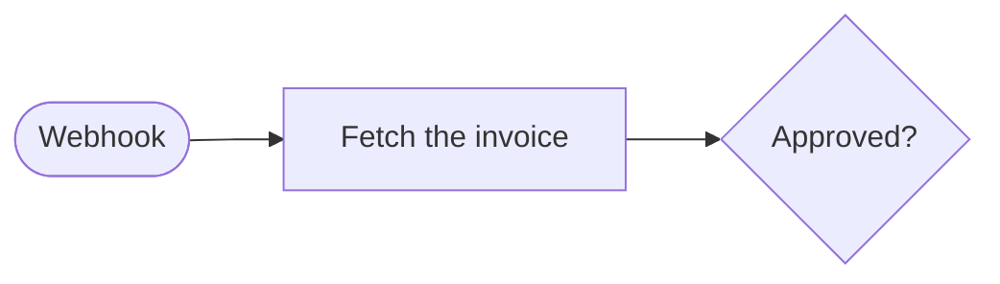

# Write an automation

An automation is a folder with a `config.yaml` and an entrypoint in Python, Node.js or TypeScript. This guide takes one from scaffold to deployment. The process contract every entrypoint follows is in the [runtime contract](../reference/runtime-contract.md), and every `config.yaml` field is in the [config reference](../reference/config.md).

## Install the CLI on your laptop

Install Node.js 22.18 or later and the Swizzle CLI package `@swizzletech/cli` from npm:

```bash
npm install --global @swizzletech/cli
swizzle --version
```

The package includes the SDKs and the builder skill. Your laptop needs no server checkout, Docker, or database. Python is needed only when you run Python automations locally.

Create an agent token in your instance's **Settings > Agent access**. Read it without adding it to shell history:

```bash
read -r -s -p 'Agent token: ' SWIZZLE_TOKEN
printf '\n'
export SWIZZLE_TOKEN
```

Add a profile with the instance's HTTPS API URL:

```bash
swizzle profile add server --url https://swizzle.example.com/api --token-env SWIZZLE_TOKEN --env staging
swizzle profile use server
swizzle doctor
```

Use your instance's real environment name instead of `staging`. The packaged stack serves its API under `/api`. Keep the token out of shell arguments.

Create a workspace for your automations in a new, empty folder:

```bash
mkdir my-automations && cd my-automations
swizzle workspace init .
```

`workspace init` writes `AGENTS.md`, an `automations/` folder and the builder skill in `.agents/skills/swizzle-builder/`, and links `.claude/skills` to it. Start your agent in this folder. `scripts/update-toolkit.sh` replaces the skill with the copy of the CLI you have installed.

Write code in that workspace on your laptop. `validate` and `apply` use the remote API. `run` executes trusted code locally, and `trigger` starts a deployed run on the server.

## Scaffold the folder

```bash
swizzle init automations/my-automation --template python
cd automations/my-automation
```

`--template` is `python`, `node` or `typescript`. To start from a shape closer to your task, add `--pattern webhook-transformer`, `document-scanner` or `cron-indexer`. `swizzle scaffolds --json` lists every template and pattern.

The Python and TypeScript scaffolds copy the SDK into the folder as `swizzle_sdk.py` or `swizzle-sdk.ts`, so the automation depends on no published package. The Node.js scaffold uses the raw contract without a helper.

## Run it locally

```bash
swizzle run .
swizzle validate .
```

With a remote profile, `swizzle validate` and `swizzle apply --dry-run` check the deployment through the API without changing it. For webhook scaffolds, store the signing key from `README.md` before validation. See [deployment checks](../explanation/deployments-and-rollback.md) for the checks the API runs.

The `swizzle validate` summary lists dependency manifests and binary requirements under `requirements`. For webhook automations, it lists the signing secret under `secrets`.

`swizzle run` uses `sample-payload.json` when the folder has one. To try another payload, pass `--payload-file ./other.json`, which avoids the shell quoting that `--payload '<json>'` needs.

A local run reads each name in `secrets` from your shell, not from the platform store. Export them first:

```bash
export API_TOKEN=replace-me
swizzle run .
```

Node 22.18 or later runs a `.ts` entrypoint directly, locally and when deployed. Node strips the types without checking them. A file that uses `import`, `export`, or top-level `await` runs as an ES module unless its `package.json` sets `"type": "commonjs"`. Node cannot strip `enum`, `namespace`, or constructor parameter properties, so leave them out. Import local files with their `.ts` extension, as the scaffold does for `./swizzle-sdk.ts`.

## Return the result on stdout

Print one JSON document on stdout and exit with code `0`. Send every log line to stderr. A stray `print()` or `console.log()` on stdout makes the run fail with `PROCESS_STDOUT_INVALID_JSON`. The SDK handler writes the result for you:

```python
from swizzle_sdk import AutomationContext, run_automation

def handle(context: AutomationContext) -> dict:
    context.log_step("received payload")
    return {"status": "ok", "run_id": context.metadata.run_id}

if __name__ == "__main__":
    raise SystemExit(run_automation(handle))
```

```ts
import { runAutomation } from "./swizzle-sdk.ts";

await runAutomation(async ({ payload, metadata, logStep }) => {
  logStep("received payload");
  return { status: "ok", runId: metadata.runId };
});
```

To fail a run, raise an exception or exit with a non-zero code. The CLI shows stderr and the next fix to try.

## Keep a value between runs

The working directory is deleted after every run. Keep cursors and other small JSON values in platform state:

```python
from swizzle_sdk import state_get, state_set

cursor = state_get("cursor", None)
state_set("cursor", "2026-07-08T12:00:00Z")
```

The TypeScript names are `stateGet` and `stateSet`. Each run reads state as it was when the run started, so `state_get` cannot tell a run that another run, started at the same time, already handled an item. Inspect or edit state from the shell with `swizzle state list <automation>`, `swizzle state get <automation> <key>`, `swizzle state set <automation> <key> <json>`, and `swizzle state delete <automation> <key>`. Store files in the target system or in object storage, not in state.

## Do a side effect once

A sender can deliver the same webhook twice, and both deliveries can run at the same time. Claim the item's key before the side effect:

```python
from swizzle_sdk import claim, read_payload, run_step

order = read_payload()
if claim(f"order:{order['id']}"):
    run_step(f"send:{order['id']}", lambda: send_confirmation(order))
```

```ts
const order = await readPayload<{ id: string }>();
if (await claim(`order:${order.id}`)) {
  await runStep(`send:${order.id}`, () => sendConfirmation(order));
}
```

`claim` returns true for exactly one run per key and environment, even when two runs claim at the same time. The holder's retries also get true, so a failed send is tried again by the same run. The step keeps a retry after a finished send from sending again. A crash inside the step can still send twice, so pass the order id to the receiving system as its idempotency key when it accepts one. The first `claim` call for a key suspends the run for a moment and starts the entrypoint again from the top, so code before it runs again. Keep that code free of side effects. In a loop, the [step](#make-work-survive-a-retry) named for each item also keeps the restart after the next claim from repeating earlier items.

The claim stays under the state key `claim:<key>`. When the holder dead-letters before the side effect, delete that key with `swizzle state delete <automation> claim:<key>` and replay the run. A local `swizzle run` holds no platform state, so `claim` always returns true there. See [claims](../reference/runtime-contract.md#claims).

## Make work survive a retry

A retry runs the entrypoint again from the top. Wrap each expensive or side-effecting call in a durable step, so a retry returns the stored result instead of calling it again:

```python
invoice = run_step("fetch-invoice-123", lambda: fetch_invoice("123"))
```

```ts
const invoice = await runStep("fetch-invoice-123", () => fetchInvoice("123"));
```

Give every step a name that is unique in the run. In a loop, put the item id in the name. A step that fails before it returns runs again on the next attempt, so a side effect inside a step must be idempotent, or get a step of its own.

State, step, and run results must survive a JSON round trip without changing. The SDK raises an error that names the value when it cannot. In TypeScript, convert `Date`, `Map`, `Set`, and class instances to plain JSON data. Omit `undefined` fields, getters, and `toJSON` methods. Convert dates with `date.toISOString()`. Python's `log_step` rejects `NaN` in its details because the runtime cannot parse it as structured log data.

## Wait without holding a worker

Each wait helper suspends the run, frees the worker, and resumes the entrypoint from the top when the wait ends. Completed steps return their stored values on resume. The helper call returns the resume value.

- To wait for a time, call `sleep_until(name, until)` or `sleep(name, seconds)`. In TypeScript, call `sleepUntil` or `sleep(name, milliseconds)`.
- To wait for an external system, call `wait_for_event(name, timeout_ms=...)` or `waitForEvent`. To let a third-party system resolve it without a Swizzle credential, give it the URL from `get_event_callback_url(name)` (`getEventCallbackUrl`) inside a step. Its `POST` body becomes the event value. The owner resolves the wait with `swizzle runs resolve-event <run> <step> --payload '<json>'` or `POST /runs/:runId/events/:stepKey`. Check `timedOut` on the result.
- To wait for a person, call `request_approval(name, details=..., assignee={"team": "Finance"}, timeout_ms=...)`. The TypeScript name is `requestApproval`. Set `assignee` to a person's email (`{"user": ...}`) or a team name. The assigned person or a current team member decides in the dashboard. Without an assignee, anyone who may run the automation can decide in the dashboard, or anyone with the step's link can decide. Send the link from `get_approval_url(name)` (`getApprovalUrl`) inside a step, then share it with the person who decides. A deployed run receives link settings when the API has `SWIZZLE_LINK_URL`; a local `swizzle run` does not. See [approval and event links](../explanation/approvals.md).
- To run another automation and use its result, call `invoke_automation(name, automation, payload)` or `invokeAutomation`. Branch on `status`, because a dead-lettered child returns as data and does not raise. The Overview groups linked automations into pipelines. It finds literal invoke targets in deployed bundles and adds child runs from the last seven days. It shows only child automations you can read.

Put the decision in the heading and the facts needed to decide in flat fields. The first non-empty `message`, `question`, `summary`, or `title` field, in that order, is the heading. The approval link page and the dashboard's Needs you list, run panel and flowchart station show it, then the other fields with labels, and format nested values as compact JSON.

```ts
await runStep("ask-finance", () => postMessage("A refund waits for Finance in Swizzle."));
const decision = await requestApproval("publish", {
  details: {
    title: "Publish refund 1,240.00 EUR to ACME GmbH?",
    invoice: "INV-1042",
    due: "2026-11-03",
  },
  assignee: { team: "Finance" },
  timeoutMs: 24 * 60 * 60 * 1000,
});
if (!decision.approved) return { status: decision.timedOut ? "timeout" : "rejected" };
```

Put the send inside a step. Without it, the team gets a new message on every resume.

A Node.js automation without the SDK prints the suspend sentinel and reads the resume value from `SWIZZLE_STEPS_FILE` itself. Both formats are in the [runtime contract](../reference/runtime-contract.md#suspend-sentinel).

## Draw the flow

Add `flow.mermaid` when you want the dashboard to show a flowchart for the automation. Give each step node the same id as its step name. Keep narration nodes, such as the trigger and result, under other ids:



Here, `fetch-invoice-123` must match a step name in the entrypoint. `trigger` and `publish` remain narration nodes.

The dashboard draws a flowchart as a track on the About tab and above the runs list. Other Mermaid diagram types still use Mermaid's renderer. The track follows the selected run, or shows reach counts when no run is selected. When recorded steps do not distinguish decision lanes, the track leaves both lanes open. You can fold the track. The browser remembers that choice. With a run selected, each finished step shows its duration beside its node.

The Play tab pairs the deployed entrypoint with the track. It colours the active step's code and dims other code. Each step's lines carry a state-coloured bracket and tag. You can replay a finished run. Replay compresses waits.

Below 900 px, the track and pipeline stack top-down. The Play tab places each node card above its first code line and wraps the code. It pins the step bar at the top and the transport at the bottom. A waiting run's approval actions sit in a bottom bar.

`swizzle validate` warns when a literal step call in the entrypoint has no node of that id, because the dashboard cannot light that step. The dashboard shows the same drift beside the track. Both use `flowDrift` and `extractFlowNodeIds` from `packages/config`, which recognize YAML front matter and semicolon-separated statements. A node without a step call, such as the trigger, a decision or an end, is narration and never warns, so a correct diagram validates clean. Warnings do not fail validation or block deployment.

## Check webhook input

Declare `trigger.payload_schema` when you know the payload's shape. Both `swizzle run` and webhook ingress reject a payload that does not match, before your code runs.

New webhook scaffolds declare a path under `/hooks/` on the API's public URL. Anyone who knows the path can POST to it. A webhook scaffold from `swizzle init` therefore gets a path that ends in a random token and a signature check over the raw body:

```yaml
trigger:
  type: webhook
  path: /hooks/orders-3f9c1a7e5b2d8c4f6a0e9b1d
  signature:
    secret: ORDERS_SIGNING_SECRET
    header: x-swizzle-signature
    prefix: sha256=
```

Ingress starts a run only when the header holds `sha256=` and the hex HMAC-SHA256 of the raw body, keyed with the secret. Any other request gets the same 404 as an unknown path. Store a random key before the first deploy and give the sender the same key:

```bash
export ORDERS_SIGNING_SECRET="$(openssl rand -hex 32)"
swizzle secret set ORDERS_SIGNING_SECRET --value-env ORDERS_SIGNING_SECRET
```

Use `swizzle trigger` or **Run now** for a manual run. These authenticated requests do not need the webhook signature. Public webhook ingress still checks it. A manual run, like a local `swizzle run`, has the trigger type `manual` and no webhook headers, so code that acts on the sender's word, such as a paid invoice, checks for `webhook` first:

```python
if context.metadata.trigger_type != "webhook":
    raise RuntimeError("only a signed delivery may mark an invoice paid")
```

In TypeScript, compare `metadata.triggerType`. The scaffold's `README.md` shows a signed `curl` request. For a sender that signs with its own header, such as `x-hub-signature-256`, change `header` and `prefix` to match it.

A secret belongs to one project and environment. For an automation outside the `default` project, add `--project <slug>`.

If the sender signs more than the body, for example a timestamp and the body, verify in code with `get_raw_body`, `get_webhook_headers` and `verify_hmac`. The TypeScript names are `getRawBody`, `getWebhookHeaders` and `verifyHmac`.

## Declare dependencies

List Python packages in `requirements.txt` or Node packages in `package.json`, and declare the manifest under `runtime.requirements`. The worker installs them into its dependency cache before a deployed run, then reuses the cached dependencies. The Compose stack sets `SWIZZLE_DEP_CACHE_DIR`. For a custom worker, set `SWIZZLE_DEP_CACHE_DIR` or `SWIZZLE_ARTIFACTS_DIR` so the worker has a cache location. Node lifecycle scripts do not run.

## Notice when an API changes

When an automation lists a connection or a secret other than its webhook signing secret, choose an `api_check` mode in `config.yaml`. `swizzle validate` and `swizzle apply` reject the automation until you choose one.

```yaml
api_check:
  mode: active
```

Choose `active` when you can make a small read-only API call. Swizzle runs the check every 7 days and after each deploy. Choose `passive` when scheduled calls would add unwanted cost. Passive recording runs under every mode, but sees only calls through `apiFetch` or `api_request`. Plain `fetch`, `requests`, and vendor SDKs are invisible. By default, Overview warns after 30 days without contact. A cron automation waits twice its interval if that is longer. Choose `off` when no API call is safe, and give a reason. Off skips active checks, but passive recording and retirement warnings continue. The [config reference](../reference/config.md) lists each mode's fields and defaults.

For `active`, edit the `check` file that `swizzle init` creates beside the entrypoint. The stub exits with a todo until you replace it. Make one small read-only call per API, and parse the response with the same function the entrypoint uses. Put the parser in a module both files can import. Do not import the entrypoint, because that runs the automation.

Use `apiFetch` in TypeScript or `api_request` in Python for the HTTP call. Those helpers report API contact and retirement headers. When the parser finds a changed field, call `contractChanged` or `contract_changed`. The SDK reference and check process rules are in the [runtime contract](../reference/runtime-contract.md).

Run the check locally:

```bash
swizzle run --check .
```

The platform cannot enforce read-only checks. If the API offers a read-only key, list it in `api_check.secrets` so the check receives only that key.

## Deploy it

```bash
swizzle apply .
swizzle trigger my-automation --payload-file ./sample-payload.json
swizzle logs my-automation
```

Set every secret and connection the automation declares before the first `apply`. A deployment binds them when it is published and fails with `PLATFORM_REQUIRED_SECRETS_MISSING` or `PLATFORM_REQUIRED_CONNECTIONS_MISSING` while one is missing. You also need `use` on each one; someone who manages it grants it, as [the security model](../explanation/security-model.md#credentials-need-use-and-manage-rights) describes.

`apply` creates a deployment in the profile's environment and prints its `#seq`. An unchanged folder changes nothing, unless a credential it binds was deleted and set again; then `apply` deploys it again to bind the new one. To undo a deploy, see [deployments and rollback](../explanation/deployments-and-rollback.md).

A deployed automation can still be unable to run: a secret it bound was deleted or its share revoked, a connection is not connected, no worker offers its runtime, or its timeout or container limits exceed what the workers allow. `swizzle list` then prints `ready=no` and a `not_ready:` line for each cause, `swizzle inspect` prints the same, and the dashboard header names it, such as "Needs secret ORDERS_API_KEY". A webhook returns the same opaque 404 as an unknown path. The dashboard and authenticated CLI show the cause only to people with access to that automation.

## Learn from the examples

[`infra/examples`](../../infra/examples/README.md) has runnable automations: `hello-webhook` uses the raw contract in Python, `typescript-webhook` and `document-scanner` use the SDK, `webhook-transformer` is plain Node.js, and `rag-indexer` runs on cron.
