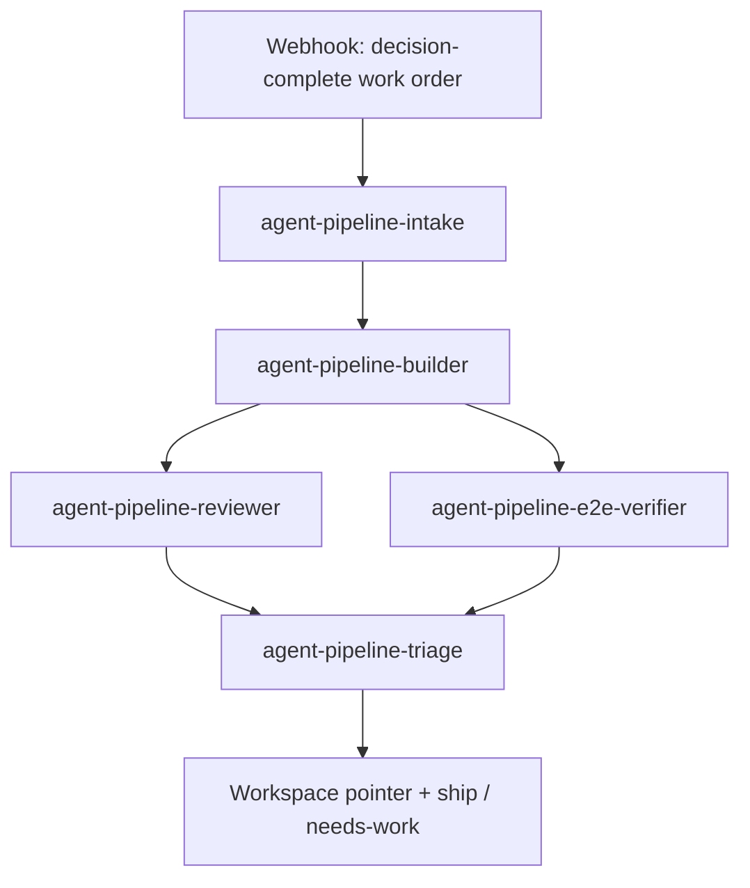

# agent-pipeline blocks

Deployable, credential-free building blocks for composing a decision-complete agent delivery workflow. The shipped full recipe is:



This is a generic template, not the production `exec-pipeline`. Its five folders are independently deployable automations. The graph lives only in each block's `trigger` config, so a planner, validator, reviewer, or verifier can be inserted, removed, or replaced without changing another block's entrypoint.

## Stable stage contract

The machine-routed envelope is deliberately small. The referenced spec stays free-form prose.

```json
{
  "repoUrl": "https://example.invalid/acme/service.git",
  "baseBranch": "main",
  "specRef": "docs/specs/healthcheck.md",
  "options": {}
}
```

The builder appends the durable workspace pointer and a human-readable summary:

```json
{
  "repoUrl": "https://example.invalid/acme/service.git",
  "baseBranch": "main",
  "specRef": "docs/specs/healthcheck.md",
  "options": {},
  "branch": "agent/work-...",
  "sha": "...",
  "summary": {}
}
```

Every downstream block returns those fields again and appends only its own result. A mutating block may advance `sha`; no block may replace the envelope with a local path, transcript, or verdict-only object.

| Block | Receives | Appends | Default trigger |
| --- | --- | --- | --- |
| `intake` | work-order envelope | normalized `options` | webhook `/agent-pipeline` |
| `builder` | work-order envelope | `branch`, `sha`, `summary` | chain from `agent-pipeline-intake` |
| `reviewer` | workspace handoff | `verdict`, `findings` | chain from `agent-pipeline-builder` |
| `e2e-verifier` | workspace handoff | `verdict`, `checks` | chain from `agent-pipeline-builder` |
| `triage` | join results | `decision`, combined `findings` | join from reviewer + verifier |

Decision-complete means that known product choices were resolved upstream. It does not mean the plan predicts the exact implementation: the builder still makes engineering choices, works iteratively, and reports assumptions or newly discovered unknowns in the pull request summary. An exploratory try/compare/discard loop is a different recipe with budget and iteration guards; these delivery blocks do not pretend to be that loop.

## Compose recipes

### Minimal: intake → build

Deploy only `intake` and `builder`. The shipped builder config already points at intake; no edits are needed. The builder's workspace handoff is the final result.

```bash
for d in intake builder; do swizzle apply infra/examples/agent-pipeline/$d; done
```

Use this when review happens locally or in an external PR system.

### Standard: intake → build → review

Deploy `intake`, `builder`, and `reviewer`. No config edits are needed. The reviewer result is the final internal result and still contains the workspace pointer.

```bash
for d in intake builder reviewer; do swizzle apply infra/examples/agent-pipeline/$d; done
```

### Full: intake → build → review ∥ E2E → triage

Deploy all five blocks in upstream-to-downstream order. This is the shipped configuration.

```bash
for d in intake builder reviewer e2e-verifier triage; do
  swizzle apply infra/examples/agent-pipeline/$d
done
```

### Planner or validator upstream

Keep the planner outside this pipeline and have it POST the stable work-order envelope to intake; nothing here changes. To insert a deployed validator block between intake and build:

```yaml
# validator/config.yaml
trigger:
  type: chain
  source: agent-pipeline-intake
  on: succeeded
  payload: result
```

Then change exactly one line in `builder/config.yaml`:

```yaml
source: your-validator-name
```

The validator must return the complete envelope it received. If validation fails, fail the run so the builder chain does not fire.

### Replace or remove internal checks

- External review only: deploy the minimal recipe; the external system consumes the builder's branch/SHA or the pull request created by your real builder.
- Replace reviewer: give the replacement a chain trigger from `agent-pipeline-builder` and replace `agent-pipeline-reviewer` in `triage/config.yaml`. Return the same pointer-preserving `{ verdict, findings }` contract; triage does not depend on the source name.
- Replace E2E: do the same for `agent-pipeline-e2e-verifier`, returning `{ verdict, checks }` with the workspace pointer.
- Use one internal check only: stop at that check's result. The shipped triage is intentionally a two-source join; do not pretend a one-source sequence is a join.

## Local contract smoke

Each block has a representative `sample-payload.json`, so every entrypoint can be exercised without deploying the whole graph:

```bash
for d in intake builder reviewer e2e-verifier triage; do
  swizzle validate infra/examples/agent-pipeline/$d
  swizzle run infra/examples/agent-pipeline/$d
done
```

After deploying a recipe, trigger its entry block with a work-order envelope:

```bash
swizzle trigger agent-pipeline-intake --payload-file infra/examples/agent-pipeline/intake/sample-payload.json
```

## Real-agent swap point

`builder/` intentionally simulates the expensive build so the blocks run anywhere. Replace only the body of `runStep("build-workspace", ...)` with the clone → agent → commit → push flow in `builder/PLAYBOOK.md` and the agent-workflow recipe. Keep the input/output envelope unchanged. A real reviewer or verifier likewise re-clones `branch` at `sha` in its own fresh run.
